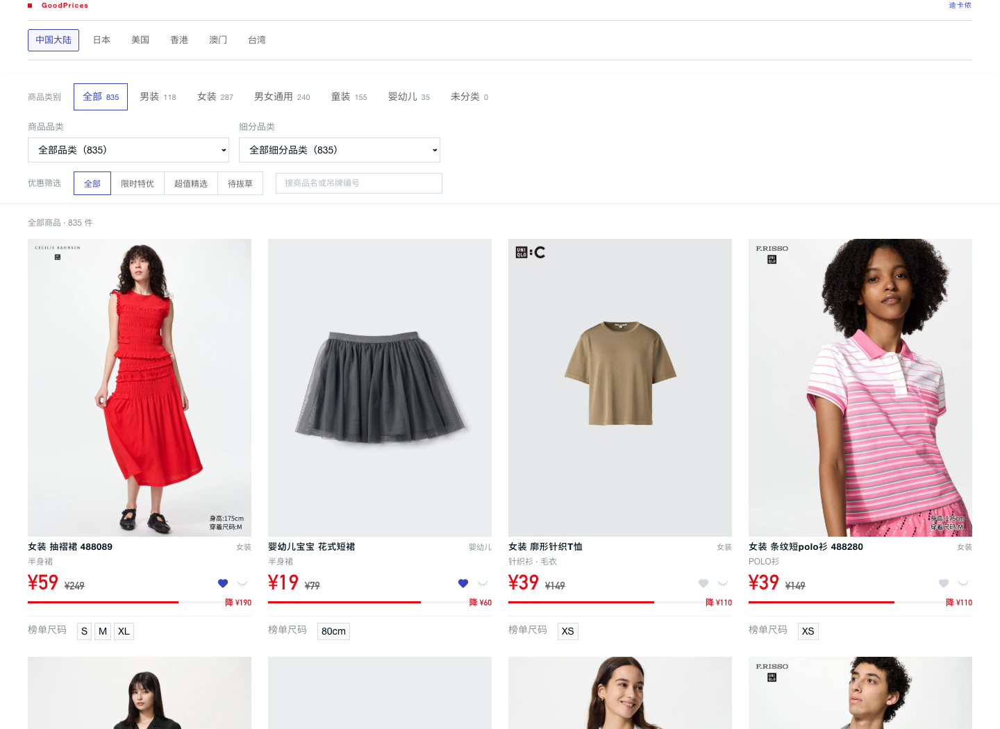

# UNIQLO Deals Explorer

**Personal shopping utility · Private application · Public project notes**

[**打开应用 → / Open app**](https://uniqlo-deals-kawai.kawaisit14.chatgpt.site/)

## 怎么使用

1. 打开应用，使用有访问权限的账号登录。
2. 选择男装／女装和服装品类，或搜索商品名称、款号，直接查看价格与榜单尺码。
3. 点击商品图片或名称前往购买；点击爱心可收藏，收藏保存在当前浏览器。

目前原网址提供中国大陆版；六地区界面已完成本地验证，仍待发布。

A compact interface for checking UNIQLO prices and offers without repeatedly opening individual product pages. The project extends a shopping-list interface inspired by GoodPrices with scheduled collection, clothing filters, region-specific browsing, and explicit source-quality states.

## Interface preview

*Screenshot of the locally tested regional extension, using public product information. This is a project preview, not a publicly accessible application.*

## Implemented behavior

- Six selectable markets: mainland China, Japan, United States, Hong Kong, Macau, and Taiwan. Each has its own source status and saved preferences.
- Clothing filters, search, locally saved favorites and hidden products. Existing favorites migrate into mainland China only.
- Currency-specific prices with cents preserved; unknown original prices do not become invented discount percentages.
- Concise Chinese product labels alongside the original official names. Size specifications are distinguished from verified purchasable sizes.
- Expired dated offers are removed. Old or inaccessible data is clearly labelled; one market's collection failure does not remove another market's data.

## Verified coverage — 14 October 2026

| Market | Current verified coverage |
| --- | --- |
| Mainland China | GoodPrices public product list; Tmall/Taobao and JD official activity checks are tracked separately. |
| Japan | Official limited-offer entry available; automated product-list requests currently restricted. |
| United States | Official limited-offer entry available; automated product-list requests currently restricted. |
| Hong Kong | Explicitly verified shared membership-coupon rules; no verified product-price list yet. |
| Macau | Only official rules explicitly applicable to Macau; no inferred Macau product prices or currency conversion. |
| Taiwan | Official entry available; a reliable public product list has not yet been obtained. |

Six selectable markets do **not** mean six working realtime product feeds. Search-engine snippets, another market's prices, catalogue size ranges, and account-specific coupons are not substituted for verified current data.

The shared Hong Kong/Macau new-member rule is conditional: first-time membership, an HKD spending threshold, account-specific coupon issuance, and a validity period after issuance. It does not establish that a visitor owns a coupon or that every product has an automatic lower price. [Official Hong Kong/Macau coupon rules](https://faq-hk.uniqlo.com/articles/en_US/Knowledge/UNIQLO-Coupon-Details-HK000012369).

## Scheduled updates and publication status

A private GitHub Actions workflow runs approximately every six hours, independently collects each market, validates results, and saves private snapshots. The mainland China update path remains compatible with the current private application.

The regional interface and import endpoints are implemented, browser-tested at desktop and mobile widths, and locally validated. Publishing that version to the original private app is currently pending restoration of the original Sites account/workspace connection. Until that publication completes, overseas collection results are saved privately and are not claimed to be live in the existing website.

After publication, the same workflow detects the regional API, imports each market separately, and reads it back to verify persistence. Failed collection retains the last valid snapshot and records the failure; stale rules stop appearing as current recommendations.

## Privacy and attribution

The application, source code, data snapshots, Actions logs, and service credentials remain private. This public page contains only a project description and a safe interface preview; the direct application link keeps its existing sign-in restriction, and no private-repository links or access credentials are exposed.

The layout was inspired by [GoodPrices](https://goodprices.online/uniqlo/), which supplies the mainland China public list. Official regional sources remain authoritative for purchase conditions, stock, membership eligibility, and checkout prices. This is an independent personal project and is not affiliated with UNIQLO.
