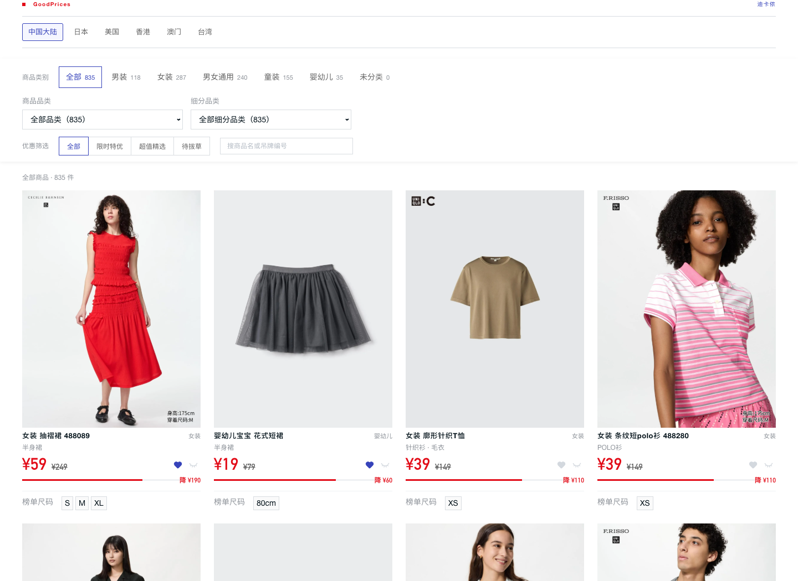

# UNIQLO Deals Explorer

**Personal shopping utility · Public application · Private original source**

[**Open app**](https://ksitcode00.github.io/uniqlo-deals-site/)

## How to use it

1. Open the app and choose English or Chinese and a region. No sign-in is required.
2. Filter by clothing category or search by name or item code. Product size ranges are not stock guarantees.
3. Select a product to visit the official store, or use the heart to save it in your browser.

Sources are checked about every six hours. Select **Load latest offers** to see the latest published list.

A compact interface for checking UNIQLO prices and offers without repeatedly opening individual product pages. The project extends a shopping-list interface inspired by GoodPrices with scheduled collection, clothing filters, region-specific browsing, and explicit source-quality states.

## Interface preview

*Interface preview using public product information. Open the application above to browse the live GitHub Pages version.*

## Implemented behavior

- Six selectable markets: mainland China, Japan, United States, Hong Kong, Macau, and Taiwan. Each has its own source status and saved preferences.
- Clothing filters, search, locally saved favorites and hidden products. Existing favorites migrate into mainland China only.
- Currency-specific prices with cents preserved; unknown original prices do not become invented discount percentages.
- Concise Chinese product labels alongside the original official names. Size specifications are distinguished from verified purchasable sizes.
- Expired dated offers are removed. Old or inaccessible data is clearly labelled; one market's collection failure does not remove another market's data.

## Verified coverage — 14 October 2026

| Market | Current verified coverage |
| --- | --- |
| Mainland China | GoodPrices public product list; Tmall/Taobao and JD official activity checks are tracked separately. |
| Japan | Official limited offers and sale products, collected anonymously through the local storefront’s public product interface with complete pagination and JPY prices. |
| United States | Official limited offers and sale products, collected anonymously through the local storefront’s public product interface with complete pagination and USD cents preserved. |
| Hong Kong | Official limited offers and sale products, including HKD prices, original prices and dated offer validity; membership rules remain separate. |
| Macau | Hong Kong/Macau official online-store offers in HKD, with the official policy confirming Macau delivery verified on every collection. Physical Macau-store MOP prices are not inferred. |
| Taiwan | Official individual limited offers and clearance products in TWD. Mixed bundle promotions and APP-only membership prices are excluded from ordinary single-item discounts. |

All six regional entries now have product-offer lists through the sources described above. Macau is explicitly an online-shopping view using HKD prices and a verified Macau delivery policy. Overseas size lists are product specifications; when a source filter lacks a size name, the product’s stated size range is shown rather than invented remaining stock. Unknown former prices do not produce discount percentages.

Macau online offers are conditional on checkout delivery coverage and inventory. The official store supports home delivery to most Hong Kong and Macau addresses, with exceptions; this does not establish Macau physical-store prices. [Official Macau delivery policy](https://faq-hk.uniqlo.com/pkb_Home_UQ_HK?fs=RelatedArticle&id=kA0Ie000000TOZz&l=en_US).

The shared Hong Kong/Macau new-member rule is conditional: first-time membership, an HKD spending threshold, account-specific coupon issuance, and a validity period after issuance. It does not establish that a visitor owns a coupon or that every product has an automatic lower price. [Official Hong Kong/Macau coupon rules](https://faq-hk.uniqlo.com/articles/en_US/Knowledge/UNIQLO-Coupon-Details-HK000012369).

## Scheduled updates and publication status

A private GitHub Actions workflow runs approximately every six hours, independently collects each market, validates results, saves private snapshots, builds the public interface, and publishes generated assets to a dedicated GitHub Pages repository. The full collection/build/publication cycle has completed successfully.

The public site uses only static assets and region-specific public JSON files. It does not depend on ChatGPT authentication, a private application API, or browser-held service credentials. The “Read latest data” button reloads published snapshots; it does not trigger collection or expose a write endpoint.

Dated expired offers are removed, failed collection retains the last valid snapshot, and old rules stop appearing as current recommendations. Source restrictions remain visible. Original source and collection logic stay in the private repository; the public deployment repository contains generated browser assets and publicly sourced snapshots.

## Privacy and attribution

The application and its published product snapshots are publicly accessible. Original source, collection workflow, and publishing credentials remain private. Favorites and hidden-product preferences are stored only in the visitor’s browser. No service credentials, private repository links, or source maps are published. Saved preferences on the old ChatGPT site cannot automatically transfer to the new github.io origin.

The layout was inspired by [GoodPrices](https://goodprices.online/uniqlo/), which supplies the mainland China public list. Official regional sources remain authoritative for purchase conditions, stock, membership eligibility, and checkout prices. This is an independent personal project and is not affiliated with UNIQLO.
